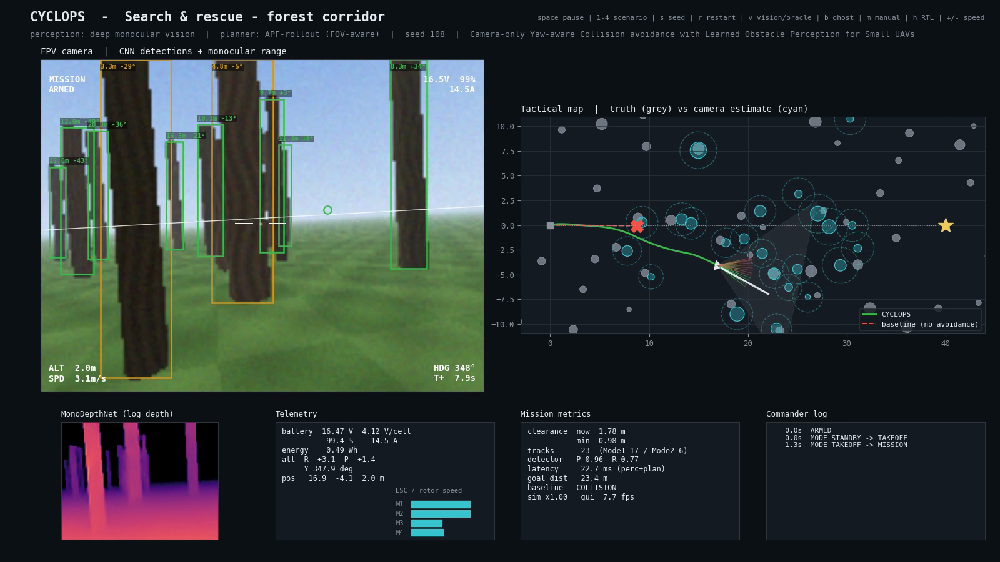
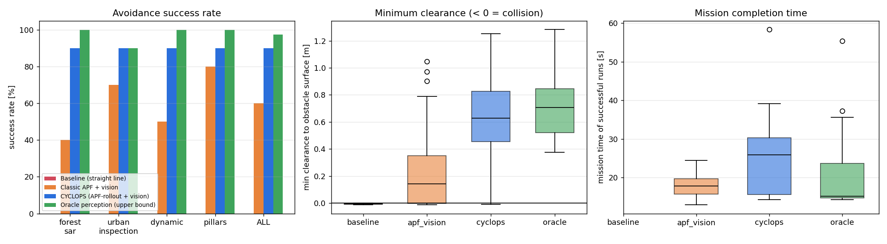
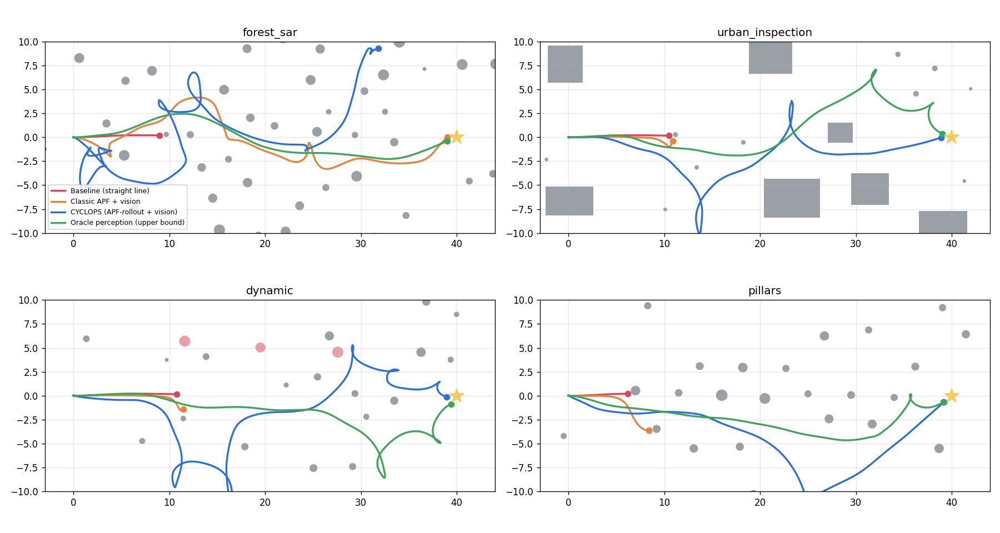

# CYCLOPS

**C**amera-only, **Y**aw-aware **C**ollision avoidance with **L**earned **O**bstacle **P**erception for **S**mall UAVs

*Deep-learning-based monocular obstacle detection and avoidance for autonomous quadrotor navigation*
Amit Singh Chauhan (23BAI1450), course BCSE428L *Autonomous Drones*



A quadrotor with **one forward-facing camera** and no LiDAR or stereo detects obstacles with a CNN and estimates their distance with a monocular depth network. It tracks them with an EKF and steers around them in real time. The project builds on

> Z. Zhang, Y. Zhang, Y. Cao, *"Monocular Vision-Based Obstacle Avoidance Trajectory Planning for Unmanned Aerial Vehicles"*, ICUAS 2020, pp. 627-632, DOI 10.1109/ICUAS48674.2020.9213901.

The paper's central idea is that avoidance should be planned around what a single camera can actually measure. CYCLOPS applies it in three ways:

* the paper's **Mode 1 (range + bearing) / Mode 2 (bearing-only)** localisation runs inside the tracker,
* every obstacle is inflated by its *estimated* uncertainty,
* the planner only moves the UAV inside the camera's field of view, so it never flies into space it has not looked at.

---

## Results (160 simulated missions, 10 unseen seeds × 4 scenarios × 4 methods)

| Method | Success | Collision | Timeout | Mean min. clearance | Mission time |
|---|---|---|---|---|---|
| Baseline: straight line, no avoidance | 0 % | 100 % | 0 % | – | – |
| Classic APF + our vision | 60 % | 40 % | 0 % | 0.40 m | 18.1 s |
| **CYCLOPS** (APF-rollout + our vision) | **90 %** | **7.5 %** | 2.5 % | **0.68 m** | 25.4 s |
| Oracle perception (upper bound) | 97.5 % | 0 % | 2.5 % | 0.71 m | 20.8 s |

CYCLOPS reaches **90 % in every scenario** (forest SAR, urban inspection, dynamic obstacles, pillar slalom), only 7.5 points below perfect perception.

| Perception (1000 held-out frames) | |
|---|---|
| Detector precision / recall (IoU 0.5, ≤ 30 m) | **0.93 / 0.76**, AP50 0.76 (0.87 within 15 m) |
| Depth network AbsRel / δ<1.25 | **0.088 / 0.92** |
| Range error: depth net vs. ground-contact geometry vs. known-size heuristic | **17 %** vs. 35 % vs. 47 % |
| Network inference on CPU (detector + depth) | **3.4 ms** (0.23 M + 0.26 M parameters) |
| End-to-end perception → tracking → planning latency | **11.4 ms mean, 23.6 ms p95** (budget 66 ms at 15 Hz) |

| Flight control (Module 5) | |
|---|---|
| Bare airframe at hover | six eigenvalues at 0: neutrally stable, needs active control |
| Roll / pitch step 10° | rise 0.23 s, overshoot 0.2 % |
| Phase margin rate / attitude loop | 72° / 68°, gain margin 18.5 dB |
| Roll attitude gain at instability | 50.6 (design value 6) |




---

## Architecture

```
 ┌────────────┐  rgb  ┌──────────────────────────────┐ detections ┌──────────────┐
 │ FPV camera │──────▶│ Perception                   │───────────▶│ EKF tracker  │
 └────────────┘       │  CNN detector (CenterNet)    │ az, el,    │ Mode 1 / 2   │
                      │  MonoDepthNet (U-Net)        │ range,     │ Hungarian    │
                      │  bearing + 3 range cues      │ width      │ CV model     │
                      └──────────────────────────────┘            └──────┬───────┘
 ┌──────────┐ IMU/GPS/baro ┌───────────┐  odometry                       │ obstacles
 │ sensors  │─────────────▶│ estimator │─────────────┬───────────────────▼───────┐
 └──────────┘              └───────────┘             │ APF-rollout planner       │
       ▲                                             │ FOV cone, stopping dist., │
       │                                             │ moving-obstacle predict.  │
 ┌─────┴──────┐  rotor ω  ┌───────────────┐  sp      └─────────────┬─────────────┘
 │ 6-DOF quad │◀──────────│ PX4-style FC  │◀── Commander ◀─────────┘ velocity + yaw
 │ ESC+battery│           │ pos→vel→att→  │   (modes, preflight,
 └────────────┘           │ rate→mixer    │    failsafes)
                          └───────────────┘
```

| Package | Contents |
|---|---|
| `cyclops/vehicle` | 6-DOF Newton-Euler quadrotor, Quad-X mixer, ESC/motor lag, LiPo battery with voltage sag; IMU/GPS/baro and a Kalman estimator |
| `cyclops/control` | PX4-architecture cascaded controller (tilt-prioritised quaternion attitude control); commander with preflight checks, flight modes and failsafes |
| `cyclops/world` | obstacle primitives and the four Module 6 application scenarios |
| `cyclops/vision` | vectorised ray-casting FPV camera producing RGB, depth and instance masks (auto-labelling) |
| `cyclops/perception` | detector and depth networks, synthetic dataset, range/bearing localisation, EKF tracker |
| `cyclops/planning` | APF-rollout (proposed), classic APF and straight-line baseline |
| `cyclops/sim` | closed-loop simulator and metrics |
| `cyclops/demo` | live dashboard |
| `ros2_ws/src/cyclops_ros` | ROS 2 perception and planner nodes for PX4 SITL + Gazebo |

How it maps onto every module of the BCSE428L syllabus: **[docs/curriculum_mapping.md](docs/curriculum_mapping.md)**.

---

## Quick start

```bash
python3 -m venv .venv && source .venv/bin/activate
pip install -r requirements.txt
python scripts/live_demo.py                      # live demo (trained weights are included)
```

Live demo keys: `space` pause · `1-4` scenario · `s` new seed · `r` restart · `v` vision ↔ oracle · `b` ghost baseline · `m` manual RC (arrows, `q`/`e` yaw, `z`/`x` altitude) · `h` RTL · `l` land · `+`/`-` speed.

Pre-recorded runs, as a fallback for the viva: [`docs/media/`](docs/media).

### Reproduce everything

```bash
python scripts/train_perception.py               # dataset + training (~30 min on Apple M-series GPU)
python scripts/train_perception.py --finetune --epochs 12   # close-range hard-example fine-tune
python scripts/evaluate_perception.py            # detection / depth / range metrics
python scripts/benchmark.py --seeds 10 --seed0 100 --workers 8
python scripts/stability_analysis.py             # Module 5
python scripts/endurance_analysis.py             # Modules 1 & 7
python -m pytest -q
```

### ROS 2 + PX4 SITL + Gazebo

```bash
# terminal 1
cd PX4-Autopilot && make px4_sitl gz_x500_mono_cam
# terminal 2
MicroXRCEAgent udp4 -p 8888
# terminal 3 (ROS 2 Humble/Jazzy with px4_msgs in the workspace)
cd ros2_ws && colcon build && source install/setup.bash
ros2 launch cyclops_ros cyclops_px4.launch.py cyclops_root:=$(realpath ..) goal_x:=40.0
```

The nodes reuse the exact `cyclops` perception, tracker and planner code. They have **not been run against a live PX4 SITL**: the development machine was a Mac without ROS 2, and only the frame conversions were unit-checked. Gazebo imagery also looks different from the built-in renderer, so the detector should be fine-tuned on a few hundred Gazebo frames first.

---

## Design notes and lessons learned

* **Synthetic self-labelled data.** The built-in renderer outputs instance and depth buffers, so both networks train without a single manual label. Domain randomisation (sun, fog, exposure, tint) improves robustness.
* **Hard-example mining.** The first depth network over-estimated range by +17 % within 1.5 m, where it matters most. That caused late reactions. Fine-tuning on 4 000 close-range frames halved the bias (+9 %).
* **Why APF-rollout instead of pure APF.** A classic APF reacts to the *current* gradient. With a forward camera, a 0.5 s velocity-loop lag and noisy monocular range, it oscillates between obstacles and swings sideways into unseen space (60 % success). Scoring candidate velocities with the same potential along short predicted rollouts makes three things explicit: stopping distance, moving obstacles and the camera field of view. That raised success to 90 %.
* **Tilt-prioritised attitude control.** A plain geometric attitude error mixes a large yaw error into roll/pitch. During fast heading changes this froze the tilt and broke velocity tracking. PX4's reduced-attitude approach fixed it.
* **Walls are not circles.** Wide detections are split into ~1 m image columns (the "stixel" idea), each localised with its own learned depth. The planner then sees building corners.

## Limitations and future work

* Obstacles approaching from outside the 90° field of view cannot be seen. One dynamic-scenario collision is of this kind; the evasive manoeuvre only helps for already-tracked movers.
* In urban scenes, online detection precision is scored conservatively (0.27): one building is often detected as several face boxes but matched against one tight ground-truth box. Flight safety is unaffected because every box becomes an obstacle.
* The formal observability analysis of the paper's Mode 2, with mode switching driven by geometry rather than depth confidence, remains future work, as stated in the project report. So does running on real hardware.

## Repository layout

```
cyclops/                 core library (see table above)
scripts/                 training, evaluation, benchmark, analyses, live demo
models/                  trained weights + training logs
results/                 metrics (JSON / CSV)
docs/figures/            all plots used in the report
docs/media/              recorded demo videos
ros2_ws/                 ROS 2 package
tests/                   pytest suite
```
